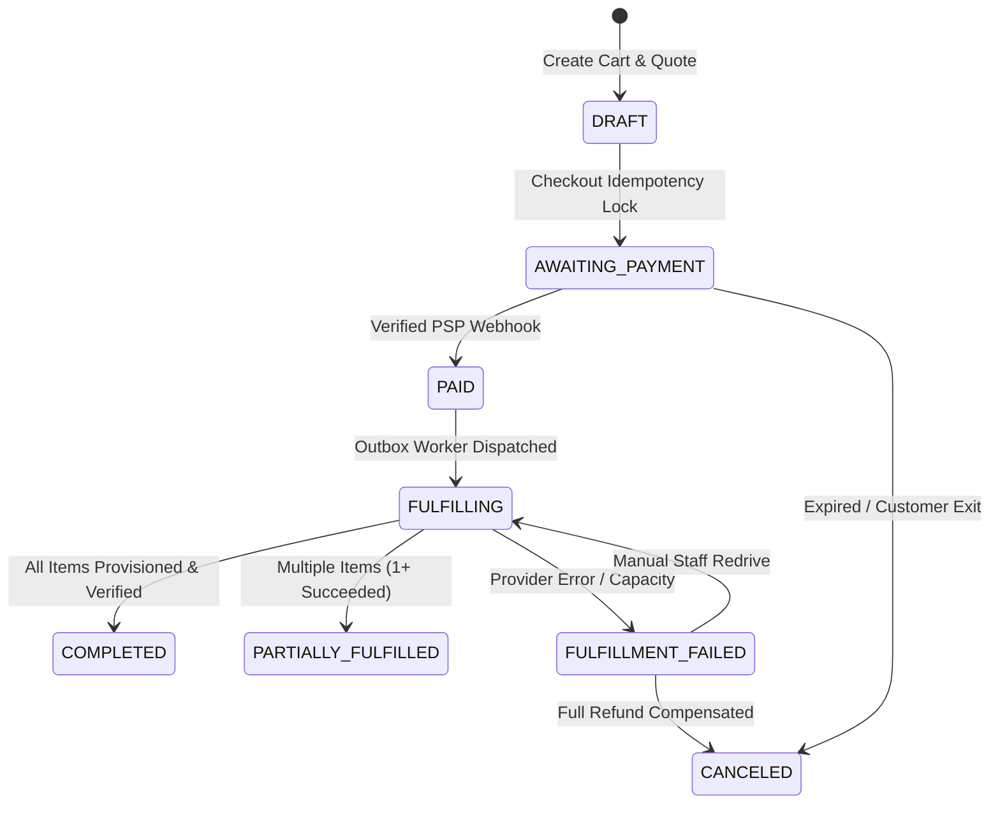

# FORTLESS — Logical Data Model & Entity Specifications

**Version:** 1.0.0-PROD  
**Status:** Approved for Implementation (Phase 0 Baseline)  
**Classification:** Core Schema Definition  

---

## 1. Data Types & Storage Invariants

1. **Monetary Precision:**  
   All monetary amounts are stored as **exact integer minor units** (e.g., Euro cents: `EUR 12.50` = `1250`) alongside an ISO 4217 currency code (e.g., `'EUR'`, `'USD'`). Floating-point arithmetic (`float`, `double`, JS `Number`) is strictly forbidden for financial calculations.
2. **Timestamps & Timezones:**  
   All database timestamps are stored in **UTC** as ISO 8601 strings or SQL `timestamptz`. Display formatting and customer timezone conversions occur strictly at the presentation layer.
3. **Primary Keys & Identifier Strategy:**  
   Entities utilize collision-resistant, sortable identifiers (K-Sortable UUIDs / ULIDs / prefixed strings such as `usr_01J8...`, `ord_01J8...`, `inv_01J8...`).
4. **Relational Constraints & Foreign Keys:**  
   Every child entity maintains strict foreign key constraints with `ON DELETE RESTRICT` for financial and contract records to prevent accidental cascading deletion.
5. **Optimistic Concurrency Control:**  
   Critical financial, contract, and service entities include a `version: integer` column to prevent lost updates during concurrent edits.

---

## 2. Complete Entity Inventory by Bounded Context

```
┌────────────────────────────────────────────────────────────────────────┐
│                        FORTLESS DATA MODEL                             │
├──────────────────┬──────────────────┬──────────────────┬───────────────┤
│    Identity      │     Catalog      │     Commerce     │ Infrastructure│
├──────────────────┼──────────────────┼──────────────────┼───────────────┤
│ users            │ categories       │ carts            │ services      │
│ auth_identities  │ products         │ cart_items       │ desired_config│
│ sessions         │ plan_versions    │ quotes           │ observed_state│
│ mfa_factors      │ plan_prices      │ quote_lines      │ providers     │
│ accounts         │ configurable_opts│ orders           │ allocations   │
│ memberships      │ option_values    │ order_items      │ provision_ops │
│ roles            │ addons           │ invoices         │ backups       │
│ permissions      │ provider_mappings│ invoice_lines    │ domains       │
│ api_tokens       │ regions          │ payment_attempts └───────────────┤
│ security_events  │ nodes            │ psp_inbox_events │  Operations   │
│ billing_profiles │ capacity_pools   │ subscriptions    ├───────────────┤
└──────────────────┤ capacity_resv    │ refunds          │ tickets       │
                   │ coupon_rules     │ credit_notes     │ ticket_msgs   │
                   │ coupon_redempt   │ finance_journal  │ audit_events  │
                   │ tax_codes        │ recon_runs       │ outbox_events │
                   └──────────────────┴──────────────────┴───────────────┘
```

### 2.1. Group 1: Identity & Authorization

#### `users`
- `id`: `String` (PK, e.g. `usr_...`)
- `email`: `String` (Unique, lowercase, normalized)
- `email_verified_at`: `DateTime?`
- `password_hash`: `String` (Argon2id format)
- `name`: `String`
- `status`: `Enum ('ACTIVE', 'SUSPENDED', 'PENDING_VERIFICATION')`
- `is_staff`: `Boolean` (Default `false`)
- `created_at`, `updated_at`: `DateTime`

#### `auth_identities` (OAuth / Social / SSO)
- `id`: `String` (PK)
- `user_id`: `String` (FK -> `users.id`)
- `provider`: `String` (e.g. `'github'`, `'google'`, `'discord'`)
- `provider_user_id`: `String`
- Unique: `(provider, provider_user_id)`

#### `sessions`
- `id`: `String` (PK, cryptographically random token hash)
- `user_id`: `String` (FK -> `users.id`)
- `ip_address`: `String`
- `user_agent`: `String`
- `expires_at`: `DateTime`
- `last_active_at`: `DateTime`
- `mfa_verified_at`: `DateTime?`

#### `mfa_factors`
- `id`: `String` (PK)
- `user_id`: `String` (FK -> `users.id`)
- `type`: `Enum ('TOTP', 'WEBAUTHN')`
- `secret_encrypted`: `String`
- `name`: `String`
- `last_used_at`: `DateTime?`

#### `accounts` (Organizations / Tenants)
- `id`: `String` (PK, e.g. `acc_...`)
- `name`: `String`
- `owner_user_id`: `String` (FK -> `users.id`)
- `billing_email`: `String`
- `status`: `Enum ('ACTIVE', 'LOCKED', 'FLAGGED_FRAUD')`
- `created_at`, `updated_at`: `DateTime`

#### `memberships`
- `id`: `String` (PK)
- `account_id`: `String` (FK -> `accounts.id`)
- `user_id`: `String` (FK -> `users.id`)
- `role`: `Enum ('OWNER', 'BILLING_MANAGER', 'TECH_ADMIN', 'VIEWER')`
- Unique: `(account_id, user_id)`

#### `billing_profiles`
- `id`: `String` (PK)
- `account_id`: `String` (FK -> `accounts.id`, Unique)
- `tax_id`: `String?` (e.g. VAT number)
- `tax_id_type`: `String?` (e.g. `'EU_VAT'`)
- `company_name`: `String?`
- `address_line1`: `String`
- `address_line2`: `String?`
- `city`: `String`
- `postal_code`: `String`
- `country`: `String` (ISO 3166-1 alpha-2, e.g. `'DE'`)

---

### 2.2. Group 2: Product Catalog & Capacity

#### `categories`
- `id`: `String` (PK)
- `slug`: `String` (Unique, e.g. `'game-servers'`, `'discord-bots'`)
- `name`: `String`
- `description`: `String`
- `sort_order`: `Integer`
- `is_active`: `Boolean`

#### `products`
- `id`: `String` (PK)
- `category_id`: `String` (FK -> `categories.id`)
- `slug`: `String` (Unique)
- `name`: `String`
- `provider_type`: `Enum ('PTERODACTYL', 'CPANEL', 'REGISTRAR', 'VPS')`
- `is_published`: `Boolean`

#### `plan_versions` (Immutable Plan Snapshots)
- `id`: `String` (PK, e.g. `plv_...`)
- `product_id`: `String` (FK -> `products.id`)
- `version`: `Integer` (Incrementing, e.g. `1`, `2`)
- `name`: `String` (e.g. `'Minecraft 4GB'`)
- `resource_specs`: `JSON` (RAM, CPU, Disk, Backups, Databases limits)
- `status`: `Enum ('DRAFT', 'ACTIVE', 'RETIRED')`
- Unique: `(product_id, version)`

#### `plan_prices`
- `id`: `String` (PK)
- `plan_version_id`: `String` (FK -> `plan_versions.id`)
- `currency`: `String` (`'EUR'`, `'USD'`)
- `interval`: `Enum ('MONTHLY', 'QUARTERLY', 'SEMI_ANNUAL', 'ANNUAL')`
- `price_minor_units`: `Integer` (e.g. `1200` for 12.00 EUR)
- `setup_fee_minor_units`: `Integer` (Default `0`)

#### `regions` & `nodes`
- `regions`: `id`, `code` (`'fra-1'`, `'lon-1'`), `name`, `country`, `is_active`
- `nodes`: `id`, `region_id`, `provider_instance_id`, `name`, `fqdn`, `max_memory_mb`, `allocated_memory_mb`, `max_disk_mb`, `allocated_disk_mb`, `maintenance_mode`

#### `capacity_reservations`
- `id`: `String` (PK)
- `node_id`: `String` (FK -> `nodes.id`)
- `plan_version_id`: `String` (FK -> `plan_versions.id`)
- `cart_item_id`: `String` (Unique)
- `expires_at`: `DateTime`
- `status`: `Enum ('RESERVED', 'CONSUMED', 'RELEASED')`

#### `coupon_rules` & `coupon_redemptions`
- `coupon_rules`: `id`, `code` (Unique, uppercase), `discount_type` (`'PERCENTAGE'`, `'FIXED_AMOUNT'`), `discount_value`, `max_redemptions`, `redemptions_count`, `expires_at`, `is_active`
- `coupon_redemptions`: `id`, `coupon_id`, `account_id`, `order_id` (Unique: `coupon_id, account_id`)

---

### 2.3. Group 3: Commerce, Billing & Accounting

#### `quotes` & `quote_lines`
- `quotes`: `id` (PK), `account_id`, `currency`, `subtotal_minor_units`, `tax_minor_units`, `total_minor_units`, `tax_calculation_snapshot` (JSON), `valid_until` (DateTime), `status` (`'OPEN'`, `'CONVERTED'`, `'EXPIRED'`)
- `quote_lines`: `id`, `quote_id`, `plan_version_id`, `quantity`, `unit_price_minor_units`, `total_minor_units`

#### `orders` & `order_items`
- `orders`:
  - `id`: `String` (PK, `ord_...`)
  - `account_id`: `String` (FK -> `accounts.id`)
  - `quote_id`: `String` (FK -> `quotes.id`)
  - `status`: `Enum ('DRAFT', 'AWAITING_PAYMENT', 'PAID', 'FULFILLING', 'COMPLETED', 'PARTIALLY_FULFILLED', 'FULFILLMENT_FAILED', 'CANCELED')`
  - `currency`: `String`
  - `total_minor_units`: `Integer`
  - `idempotency_key`: `String` (Unique)
  - `created_at`, `updated_at`: `DateTime`
- `order_items`:
  - `id`: `String` (PK, `ori_...`)
  - `order_id`: `String` (FK -> `orders.id`)
  - `plan_version_id`: `String` (FK -> `plan_versions.id`)
  - `region_id`: `String`
  - `custom_options`: `JSON`
  - `fulfillment_status`: `Enum ('PENDING', 'FULFILLED', 'FAILED')`
  - `service_id`: `String?` (Unique, FK -> `services.id`)

#### `invoices` & `invoice_lines`
- `invoices`:
  - `id`: `String` (PK, `inv_...`)
  - `account_id`: `String` (FK -> `accounts.id`)
  - `order_id`: `String?` (FK -> `orders.id`)
  - `invoice_number`: `String?` (Unique, e.g. `'INV-2026-00001'`)
  - `status`: `Enum ('DRAFT', 'ISSUED', 'PAID', 'OVERDUE', 'VOIDED', 'CREDITED')`
  - `currency`: `String`
  - `subtotal_minor_units`: `Integer`
  - `tax_minor_units`: `Integer`
  - `total_minor_units`: `Integer`
  - `amount_paid_minor_units`: `Integer`
  - `due_date`: `DateTime`
  - `paid_at`: `DateTime?`
  - `created_at`: `DateTime`
- `invoice_lines`:
  - `id`: `String` (PK)
  - `invoice_id`: `String` (FK -> `invoices.id`)
  - `description`: `String`
  - `quantity`: `Integer`
  - `unit_price_minor_units`: `Integer`
  - `tax_rate_basis_points`: `Integer` (e.g. `1900` for 19.00%)
  - `total_minor_units`: `Integer`

#### `payment_attempts` & `payment_transactions`
- `payment_attempts`:
  - `id`: `String` (PK, `pay_...`)
  - `invoice_id`: `String` (FK -> `invoices.id`)
  - `psp_name`: `String` (`'stripe'`)
  - `psp_session_id`: `String?`
  - `psp_payment_intent_id`: `String?`
  - `status`: `Enum ('CREATED', 'REQUIRES_ACTION', 'PROCESSING', 'SUCCEEDED', 'FAILED', 'CANCELED')`
  - `amount_minor_units`: `Integer`
  - `currency`: `String`
  - `idempotency_key`: `String` (Unique)
- `psp_inbox_events`:
  - `id`: `String` (PK)
  - `psp_name`: `String`
  - `merchant_account`: `String`
  - `event_id`: `String` (Unique with `psp_name, merchant_account`)
  - `event_type`: `String`
  - `payload_digest`: `String` (SHA-256)
  - `payload`: `JSON`
  - `status`: `Enum ('RECEIVED', 'PROCESSED', 'FAILED', 'IGNORED')`
  - `processed_at`: `DateTime?`

#### `subscriptions`
- `id`: `String` (PK, `sub_...`)
- `account_id`: `String` (FK -> `accounts.id`)
- `service_id`: `String` (Unique, FK -> `services.id`)
- `status`: `Enum ('ACTIVE', 'PAST_DUE', 'CANCEL_SCHEDULED', 'CANCELED', 'TERMINATED')`
- `billing_interval`: `Enum ('MONTHLY', 'QUARTERLY', 'ANNUAL')`
- `current_period_start`: `DateTime`
- `current_period_end`: `DateTime`
- `next_renewal_date`: `DateTime`
- `renewal_price_minor_units`: `Integer`
- `currency`: `String`
- `auto_renew`: `Boolean`

#### `refunds` & `credit_notes`
- `refunds`: `id`, `payment_attempt_id`, `amount_minor_units`, `reason`, `status` (`'REQUESTED'`, `'SUCCEEDED'`, `'FAILED'`), `psp_refund_id`
- `credit_notes`: `id`, `invoice_id`, `credit_note_number` (Unique, e.g. `'CRN-2026-00001'`), `amount_minor_units`, `reason`, `created_at`

---

### 2.4. Group 4: Infrastructure & Technical Provisioning

#### `services`
- `id`: `String` (PK, `svc_...`)
- `account_id`: `String` (FK -> `accounts.id`)
- `order_item_id`: `String` (Unique, FK -> `order_items.id`)
- `provider_type`: `Enum ('PTERODACTYL', 'CPANEL', 'REGISTRAR', 'VPS')`
- `provider_instance_id`: `String`
- `external_id`: `String?` (Provider resource ID, e.g. Pterodactyl Server ID)
- `identifier`: `String?` (Provider UUID / slug)
- `contract_status`: `Enum ('ACTIVE', 'PAST_DUE', 'SUSPENDED', 'CANCELLED', 'TERMINATED')`
- `node_id`: `String` (FK -> `nodes.id`)
- `created_at`, `updated_at`: `DateTime`

#### `service_desired_configs` & `service_observed_states`
- `service_desired_configs`: `service_id` (PK), `plan_version_id`, `cpu_limit_pct`, `memory_limit_mb`, `disk_limit_mb`, `startup_command`, `environment_variables` (Encrypted JSON)
- `service_observed_states`: `service_id` (PK), `runtime_state` (`'RUNNING'`, `'STOPPED'`, `'INSTALLING'`, `'ERROR'`, `'OFFLINE'`), `last_checked_at`, `raw_metrics` (JSON)

#### `provision_operations` (Saga State Tracking)
- `id`: `String` (PK, `pop_...`)
- `service_id`: `String` (FK -> `services.id`)
- `operation_type`: `Enum ('CREATE', 'SUSPEND', 'UNSUSPEND', 'RESIZE', 'TERMINATE')`
- `status`: `Enum ('PENDING', 'IN_PROGRESS', 'VERIFYING', 'SUCCEEDED', 'NEEDS_MANUAL_REVIEW', 'FAILED')`
- `idempotency_key`: `String` (Unique)
- `correlation_id`: `String`
- `attempt_count`: `Integer`
- `last_error`: `String?`
- `created_at`, `updated_at`: `DateTime`

---

### 2.5. Group 5: Operations, Support & Reliability

#### `tickets` & `ticket_messages`
- `tickets`: `id` (PK, `tkt_...`), `account_id`, `created_by_user_id`, `assigned_staff_id?`, `subject`, `priority` (`'LOW'`, `'NORMAL'`, `'HIGH'`, `'URGENT'`), `status` (`'OPEN'`, `'WAITING_CUSTOMER'`, `'WAITING_STAFF'`, `'RESOLVED'`, `'CLOSED'`), `created_at`
- `ticket_messages`: `id`, `ticket_id`, `author_user_id`, `is_staff_internal_note`, `body` (Sanitized Markdown), `created_at`

#### `audit_events` (Append-Only)
- `id`: `String` (PK, `aud_...`)
- `account_id`: `String?`
- `actor_user_id`: `String?`
- `actor_type`: `Enum ('USER', 'STAFF', 'SYSTEM', 'PSP_WEBHOOK')`
- `action`: `String` (e.g. `'service.power.start'`, `'invoice.issue'`)
- `resource_type`: `String`
- `resource_id`: `String`
- `ip_address`: `String?`
- `correlation_id`: `String`
- `metadata`: `JSON`
- `created_at`: `DateTime` (Strictly append-only)

#### `outbox_events` (Transactional Event Bus)
- `id`: `String` (PK, `obx_...`)
- `event_type`: `String` (e.g. `'order.paid.v1'`, `'service.provision.v1'`)
- `aggregate_type`: `String`
- `aggregate_id`: `String`
- `payload`: `JSON`
- `status`: `Enum ('PENDING', 'PROCESSING', 'COMPLETED', 'DEAD_LETTER')`
- `retry_count`: `Integer`
- `scheduled_at`: `DateTime`
- `created_at`: `DateTime`

---

## 3. Mandatory State Machine Definitions



### 3.1. Order State Transitions
- `DRAFT`: Unsubmitted cart with temporary resource reservation.
- `AWAITING_PAYMENT`: Order locked against quote; PSP hosted session active.
- `PAID`: Authoritative PSP payment confirmed. Provisioning entitlement created.
- `FULFILLING`: Outbox job running; provider API call initiated.
- `COMPLETED`: Server fully created, verified, and operational.
- `FULFILLMENT_FAILED`: Escrowed paid order requiring manual review or refund compensation.

### 3.2. Invoice State Transitions
`DRAFT` -> `ISSUED` -> `PAID` (or `OVERDUE` -> `SUSPENDED_GRACE`) -> `VOIDED` (pro-forma only) / `CREDITED` (fiscal with Credit Note).
